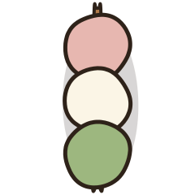
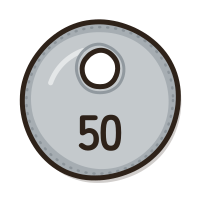

# おみせで おかいもの — デザイン設計

もとにしたもの: `lesson-plan.md`（ステップ・ことば）、`kikakusho.md`「7. 見た目のイメージ」（昭和の駄菓子屋・商店街の手描き看板、木の棚、はり紙、手書きねふだ）

## 1. テーマ:「だがしや まるや」

商店街のかどにある、昭和の小さな駄菓子屋。生徒は お客さんとして店に入り、おばあちゃん（おみせの ひと）と やりとりする。

- **かべ**: 砂かべ色のざらっとした紙（CSSのノイズで描く。動かない）
- **木**: たな板・カウンター・看板のわく。木目は静止したノイズ
- **はり紙**: 問題文は、かべにマスキングテープで とめた紙に書く（少しだけ かたむける）
- **ねふだ**: 白い厚紙に、マジックで手書きした数字（Yusei Magic）
- **看板**: えんじ色の板に、白い手書き文字。くぎ・ひもで つるす
- **切り絵**: キャラクター・だがし・硬貨は、墨の太い線でふちどった切り絵ふう。線は手描きのように少しゆれる

いちばん目立たせるもの（1つだけ）: **手書きのねふだの数字**。ほかは しずかにまとめる。
使わないもの: グラデーション背景、発光、すりガラス、同じ角丸カードのならび、絵文字（「🔈」も使わず、自作のアイコン＋ことば）。

## 2. 色

テーマ色は4色（木・えんじ・藍・山吹）＋背景（砂かべ・紙）＋墨。彩度はおさえめ、あたたかい色。

| 名前 | CSS変数 | コード | つかう場所 |
|---|---|---|---|
| 砂かべ | `--kabe` | `#E6D5B3` | 画面の背景 |
| かべの影 | `--kabe-dark` | `#D6C095` | 地面・くぎ |
| 紙 | `--kami` | `#FBF5E6` | はり紙・ねふだ・ボタンの地・ことば欄 |
| 墨 | `--sumi` | `#2E2219` | 文字・ふちの線 |
| 木 | `--ki` | `#8B5A33` | たな・カウンター |
| こい木 | `--ki-dark` | `#5E3A1E` | わく・ふち・画面の外（店のおく） |
| えんじ | `--enji` | `#A3352B` | 看板・はなまる・「おてほん」札 |
| 藍 | `--ai` | `#2C4A6E` | 押せるもの（大きいボタン・よむ）・フォーカス・ヒントのわく |
| 山吹 | `--yamabuki` | `#E3B23C` | 進みぐあいの「おわった」・こたえの ゆっくり光るわく・テープ |
| トレー | （直書き） | `#6E8F7A` | 古いゴムの おさら |

### コントラスト（WCAG AA 4.5:1 以上を確認ずみ）

| 文字 | 背景 | 比 |
|---|---|---|
| 墨 `#2E2219` | 紙 `#FBF5E6` | 14.2 |
| 墨 | 砂かべ `#E6D5B3` | 10.7 |
| 紙 | 藍 `#2C4A6E`（ボタン） | 8.4 |
| 紙 | えんじ `#A3352B`（看板） | 6.2 |
| 紙 | 木 `#8B5A33` | 5.4 |
| 藍 | 紙（設定ボタンの文字） | 8.4 |
| 10えん色 `#7C4122`（ねふだの十のくらい） | 紙 | 7.3 |
| 1えん色 `#59626A`（ねふだの一のくらい） | 紙 | 5.7 |
| 墨 | 山吹（ヒントの札） | 7.9 |
| 硬貨の数字 | 各硬貨の面 | 1円 13.0／5円 7.0／10円 5.4（白い数字）／50円 9.3／100円 7.9 |

- 硬貨は全部、墨の太い線（5px）でふちどる → どの背景の上でも 3:1 以上で形が見える
- トレーの上の文字（紙色 on `#6E8F7A`）は 3.3:1 なので（大きい文字の基準 3:1 は満たす）、**28px以上・太字**で使い、数字は紙色の札の上に墨で書く（`.tray__total-num`）

### 色だけで伝えない
| 伝えること | 色 | 色いがいの手がかり |
|---|---|---|
| せいかい | えんじ | はなまるの形・「よくできた！」のことば・おばあちゃんが にっこり |
| もういちど | 藍 | むしめがねの絵・点線のわく・「もういちど みてみよう」。×・赤・ゆれは使わない |
| ヒント | 藍 | 実線の二重わく・まるで かこむ・数字の札 |
| 進みぐあい | 山吹／藍 | おわった=中に ✓／いま=太いわく／まだ=点線 |
| 十のくらい・一のくらい（ステップ3） | ちゃいろ／はいいろ | 数字の下に 10えん・1えん の小さな絵 |

## 3. 硬貨の絵のきまり（要確認事項の決定）

実物の模写はしない。**色・大きさ・数字・穴**の4つだけで見分ける簡略な切り絵。数字は全部の硬貨に大きく書く（実物の5円には数字がないが、学習のために書く）。

| 硬貨 | ファイル | 色の言い方（声・文字で同じ） | 面の色 | 穴 | 大きさ（絵の中の半径 / 200） |
|---|---|---|---|---|---|
| 1円 | `assets/coin-1.svg` | **しろっぽい ぎんいろ** | `#E9ECEA` | なし | 70（いちばん小さい） |
| 50円 | `assets/coin-50.svg` | **ぎんいろ・あなが ある** | `#C4C9CC` | あり | 78 |
| 5円 | `assets/coin-5.svg` | **きんいろ・あなが ある** | `#D6A83E` | あり | 84 |
| 100円 | `assets/coin-100.svg` | **ぎんいろ・あなが ない・50えんより おおきい** | `#B4BAC0` | なし | 90 |
| 10円 | `assets/coin-10.svg` | **ちゃいろ**（「どういろ」とは言わない） | `#9A5530` | なし | 96（いちばん大きい） |

決めたこと
- **大きさ**: 実物の大きさの順番（1 < 50 < 5 < 100 < 10）を守ったまま、差を少しだけ大きくした（1円は10円の約0.73倍）。大きさは「たすけ」の手がかりで、大きさだけで答えさせる問題・ヒントは作らない。
  - 「100えんは 大きめ」は **50えん・1えんと くらべて** 言う（「10えんより 大きい」は まちがいになるので言わない）
- **1円の言い方**: 「しろっぽい ぎんいろ」。「かるい」は重さのことばで、絵では伝わらないので色の説明には入れない（ふり返りや説明で「いちばん ちいさい」とは言ってよい）
- **50円と100円**（どちらも ぎんいろ）: 「あなが ある／ない」と数字で見分ける。100円の面は50円より少しだけ こい ぎんいろ（ほじょ）
- **穴**は本当に抜いてある（うしろの色が見える）。穴のふちは墨の太線＋内側の線で、二重に かこんでいる
- 数字は字形をパスにしてある（フォントが無いパソコンでも同じ形）
- 硬貨の絵はすべて `viewBox="0 0 200 200"` で、同じ大きさの箱に入れれば、自動で大きさの差が出る。硬貨の大きさを CSS で個別に変えないこと
- 穴の中心（ヒントで まるを かこむ位置）: 50円は上から 34.4%、5円は 33.2%（`.hint-hole--50` / `--5` に入れてある）

## 4. 文字

| 用途 | 書体 | 太さ | 大きさ（基準1920×1080） |
|---|---|---|---|
| 本文・ことば・ボタン | Zen Maru Gothic（丸ゴシック） | 500 / 700 | 本文 32px、ボタンのことば 28〜40px |
| 問題文 | Zen Maru Gothic | 700 | 52px（2行になる文は `.question--long` 44px） |
| 看板・ねふだの数字・「おてほん」札・トレーの合計 | Yusei Magic（マジックの手書き） | 400 | ねふだ 150px、タイトル看板 132px、HUD看板 56px |

- フォントは `fonts/` に同梱（woff2・SIL OFL 1.1。ライセンス文も同梱）。`style.css` の先頭で `@import url("fonts/fonts.css")` 済み。ネットなしで動く
- 無い環境の代わり: BIZ UDPゴシック → ヒラギノ丸ゴ → メイリオ
- 行間 1.7（問題文 1.6）。ふりがな `<rt>` は 0.5em（本文で16px、問題文で26px）
- 文は単語ごとにスペースを入れて書き、`word-break: keep-all` でスペースの所で折りかえす
- 大きさの考え方: 画面は 1920×1080 の舞台を丸ごと縮める。1280×720 では 2/3 になるので、**最小 28px・ボタン 180px** で作り、縮めても 19px・120px 以上を保つ

## 5. 画面の基本配置（全ステップ共通・位置は動かさない）

```
 x: 40        560 600                                             1880
   +-----------------------------------------------------------------+  y=0
   | [1] 看板「おかねを しろう」  ○✓ ○✓ ◎ ◌ ◌        [おと][うごき][もどる] |  HUD 150
   |                          ステップ1 ／ 3もんめ ／ ぜんぶで 5もん          |
   +------------------+----------------------------------------------+  y=170
   |                  | はり紙（問題文 52px）            [ よむ ]      |  180
   |  おみせの ひと    |  ~テープ~                     ~テープ~        |
   |  （300×360）     +----------------------------------------------+  y=370
   |                  |                                              |
   +------------------+  あそぶところ 1280×480                         |
   |  木のたな         |   ステップ1: 硬貨のボタン 2〜3まい               |  480
   |  だがし＋ねふだ    |   ステップ2・3: 左に「山」 右に「トレー」         |
   |  （520×300）      |  ================= たな板 ================== |
   +------------------+----------------------------------------------+  y=870
   | 木のカウンター                                                     |
   |  [ ことば欄（ほめる・ヒント） [よむ] ]          [ 大きいボタン 420×172 ] |  210
   +-----------------------------------------------------------------+  y=1080
```

- 左右の位置: 問題文はつねに右上のはり紙、えらぶものは右の中央、大きいボタンはつねに右下、設定はつねに右上
- 大きいボタンを使わない場面（ステップ1の答える前）も、**場所は空けたまま**（`hidden` でも見えないだけで場所はのこる）
- ことば欄の しっぽは、左上の おみせの ひとに向く
- 文字はすべて左ぞろえ（看板・ボタンの中だけ中央）

## 6. 各画面

### 6-1. タイトル
```
+-----------------------------------------------------------------+
|                                               [おと][うごき][もどる]|
|   |ひも        |ひも                                             |
|  +------------------------------------------+   しょうてんがいの    |
|  | だがしや まるや                             |   店のならび（絵）    |
|  |  お み せ で  お か い も の  （手書き 132px）|                     |
|  +------------------------------------------+   (かたむき -2.5°)    |
|                       +----------------------+                    |
|                       | いらっしゃい！         |   おばあちゃん        |
|                       | おかいものを しよう     |   （にっこり 400×480）|
|                       +----------------------+                    |
|  ~~~~~~~~~ 石だたみ ~~~~~~~~~~~~~~~~~~~~~~~~~~~   [ はじめる ]       |
+-----------------------------------------------------------------+
```
- 背景: `assets/shotengai.svg`（静止）。3Dの演出（硬貨・だがしが ふわっと浮かぶ）は 看板と おばあちゃんの間・上の空にだけ出す
- 「はじめる」で `Sound.start()`。おばあちゃんの声（読み上げ）「いらっしゃい！ おかいものを しよう」

### 6-2. おてほん（各ステップの はじめ）
```
| [2] 10えんで かおう   ◎ ◌ ◌ ◌ ◌                       [おと][うごき][もどる] |
|                +------------------------------------------------+ |
|  おばあちゃん    |[おてほん] 20えんの だがしを かおう      [よむ]  | |
|                +------------------------------------------------+ |
| +-------------+ +----------+   +--------------------------------+ |
| | あめ  20えん | | 10えんだま |   | いま 10 えん                     | |
| |  （ねふだ）   | |   (山)    |   | (10)                             | |
| +-------------+ +----------+   +--------------------------------+ |
|                     ☝(手が 山 → トレー と ゆっくり動く)                  |
| [ ねふだと おなじに なったね。これで おねがいします  [よむ]]  [ やってみる ] |
```
- はり紙の左上に えんじの「おてほん」札（`.tag-otehon`）
- 手（`assets/hand.svg`・`.hand`）は `left/top` を変えて 0.9秒で移動、押すとき `.is-press`。点滅しない。「うごきをへらす」では移動せず、押す場所に いきなり出す
- おてほんの間、生徒が押せるのは「よむ」と設定だけ。最後に大きいボタンが「やってみる」になる
- ステップ1のおてほん: 10円と1円の2まい。10円に手が行き、そのボタンに `.is-answer`（ゆっくり明るくなるわく）。ことば「ちゃいろで 10と かいてあるね」→「こんどは きみの ばんだよ」
- ステップ3のおてほん: ねふだ「12えん」を `.nefuda__ju`（1）と `.nefuda__ichi`（2）で色分け

### 6-3. 問題 — ステップ1「おかねを しろう」
```
|  おばあちゃん    | (●) 10えんだまを ください                 [よむ] |
|  （ふつう）      +-----------------------------------------------+
| +-------------+    +--------+    +--------+    +--------+         |
| | あめ   ぐみ   |    | (10)   |    |  (1)   |    |  (5)   |         |
| | （かざり）     |    | 10えん  |    | 1えん   |    |  5えん  |         |
| +-------------+  ==+========+====+========+====+========+== たな  |
| [ （ことば欄は からっぽ。見えない） ]                       [ (空き) ] |
```
- 問いの横の「ヒントのまる」は `.question__coinhint` に正解の硬貨の絵を出す（lesson-plan「絵や図のヒント」）
- 硬貨ボタン `.coin-choice` 300×340、間 72px。中の絵 240px、下に「10えん」のことば
- 左下のたなは かざり（`.shelf--quiet`、あめ・ぐみ。うごかない）
- キーボード: 1・2・3 キーで左から えらぶ。画面には キーの数字を書かない（硬貨の数字とまぎれるため）

### 6-4. 問題 — ステップ2「10えんで かおう」／ステップ3「10えんと 1えんで かおう」
```
|                | 23えんの だがしを かおう                    [よむ] |
| +-------------+ +------------------+  +-------------------------+ |
| |      +-----+| | (10)(10)  10えんだま|  | いま [21] えん             | |
| | だんご|だんご|| |  山      おして のせる| | ┌10えんの おへや─────────┐ | |
| |  絵  | 2 3 || +------------------+  | │(10)(10)               │ | |
| |      | 🟤 ⚪|| +------------------+  | └──────────────────┘ | |
| |      | えん || | (1)(1)  1えんだま  |  | ┌1えんの おへや──────────┐ | |
| |      +-----+| |  山      おして のせる| | │(1) ◌ ◌                 │ | |
| +-------------+ +------------------+  +-------------------------+ |
| [ ことば欄 ]                                   [ これで おねがいします ] |
```
- 山（`.coin-pile`）は上=10えん、下=1えん で固定。ステップ2では下の山は `hidden`（場所だけ のこる）
- トレー（`.tray`）は ステップ2は1へや（`.tray__room` 1つ・5まい×2だん）、ステップ3は `.tray--two` で2へや（上=10えん、下=1えん。山と同じ高さに ならぶ）
- トレーの硬貨（`.tray-coin` 132px、ステップ2は120px）を押すと山にもどる。6まい以上は `.is-crowded` で少し かさねる
- 合計「いま ○○ えん」はつねに表示（`.tray__total-num`、手書き 60px）
- ねふだ（`.nefuda`）: だがしの名前（ひらがな）＋手書きの数字＋「えん」。ステップ2問1・2は下に うすい見本のまる（`.nefuda__guide` の span をねだん÷10個）。問3・4は数字の十のくらいを `.nefuda__big`
- 「これで おねがいします」はつねに右下

### 6-5. せいかい
```
|  おばあちゃん    | (●) 10えんだまを ください        (はなまる)  [よむ] |
|  （にっこり）    +-----------------------------------------------+
|                  +--------+    +========+✿                       |
|                  | (1)    |    ‖ (10)   ‖  ← えんじの二重わく      |
| [✿ よくできた！ ちゃいろの 10えんだま だね  [よむ]]            [ つぎへ ] |
```
- おばあちゃんを `shopkeeper-smile.svg` に かえる
- はり紙の右に はなまる（`.stamp-hanamaru`）、えらんだボタンに `.is-correct`
- ことば欄 `.message--good`（はなまる＋太字。最初のことば「よくできた！」を `<em>` で下線）
- ステップ2・3: トレーの上で 3Dの紙ふぶき。だがしの絵は 3D演出のあと ふくろへ（ふり返りで数える）
- 大きいボタンが「つぎへ」になる。自動では進まない（自分のペースで）

### 6-6. もういちど・ヒント
| 回 | 見た目 | ことば欄 | おばあちゃん |
|---|---|---|---|
| 1回目 | 何も消さない。ことばだけ | `.message--retry`（むしめがね・藍の点線わく）「もういちど みてみよう」など lesson-plan のことば | `shopkeeper-think.svg`（ほおに手） |
| 2回目（つよいヒント） | 正解のボタンに `.hint-frame`（10円は `--10`、1円は `--1`）。ステップ1問3は ほかに `.is-dim`、問4は `.hint-hole--50`、問2・5は `.hint-num`（数字の札）。ステップ2・3はトレーに `.coin-slot`（点線のまる。10えん=ちゃいろの破線 `--10`、1えん=白い点 `--1`）、問4は `.tray-mark`「ここまで 50」 | `.message--hint`（むしめがね・藍の実線わく） | think |
| 3回目 | 正解に `.is-answer`（山吹のわくが 2.4秒で1回 ゆっくり太くなる。点滅ではない）＋ `.hand` がいっしょに押す | 「いっしょに かぞえよう」 | ふつう |
- 赤・×・ブブー音・画面のゆれは使わない。うすくした硬貨（`.is-dim`）も押せる

### 6-7. ステップクリア
- はり紙の中のことばを `.stepclear-text`（えんじの手書き 76px）で「ステップ1 できた！」にかえる
- `Motion3D.stepClear(n)` で、はなまるの3Dスタンプが はり紙の上に「ドン」と おされる（2秒以内）
- 大きいボタン「つぎの ステップへ」

### 6-8. ふり返り
```
| 看板「ふりかえり」                                  [おと][うごき][もどる] |
| +--------------+ +----------------------------------------------+ |
| |  (だがしが     | | きょうの おかいもの、おしまい！ よく がんばったね [よむ]| |
| |   のぞく)      | +----------------------------------------------+ |
| |  ふくろ「だ」   | |✿ おかねが わかったね           (1)(5)(10)(50)(100)| |
| |              | |✿ 10えんだまを かぞえて かえたね      (10)(10)(10)  | |
| | かったもの 8こ  | |✿ 10えんと 1えんで ぴったり かえたね (10)(10)(1)(1) | |
| +--------------+ +----------------------------------------------+ |
| [ また おかいもの しようね  [よむ] ]          [ おわる ]  [ もういちど あそぶ ] |
```
- ふくろ `assets/bag.svg` の口から、買っただがし（ステップ2・3の8こ）が のぞく（`.result-bag__items`）
- 3つの「できたこと」は `.result-item`（左に はなまる、右に硬貨の絵）。`Motion3D` は スタンプを1つずつ光らせる（ふわっと明るく）
- 「おわる」は弱いボタン（`.btn-main--sub`）。まちがえた回数・点数は出さない

## 7. だがし（ねだんと絵）

| 場面 | ねだん | なまえ（画面の文字） | ファイル |
|---|---|---|---|
| ステップ2 おてほん | 20えん | あめ | `assets/dagashi-ame.svg` |
| ステップ2 問1 | 30えん | らむね | `assets/dagashi-ramune.svg` |
| ステップ2 問2 | 50えん | せんべい | `assets/dagashi-senbei.svg` |
| ステップ2 問3 | 40えん | ちょこ | `assets/dagashi-choco.svg` |
| ステップ2 問4 | 70えん | わたがし | `assets/dagashi-watagashi.svg` |
| ステップ3 おてほん | 12えん | ぐみ | `assets/dagashi-gumi.svg` |
| ステップ3 問1 | 23えん | だんご | `assets/dagashi-dango.svg` |
| ステップ3 問2 | 31えん | きゃらめる | `assets/dagashi-kyarameru.svg` |
| ステップ3 問3 | 14えん | ぜりー | `assets/dagashi-zeri.svg` |
| ステップ3 問4 | 42えん | くっきー | `assets/dagashi-kukki.svg` |

## 8. 効果音・演出を出すところ

| とき | Sound | Motion3D | 画面（CSS） |
|---|---|---|---|
| タイトル表示 | — | `setScene('title')`（硬貨・だがしが奥から出て、ゆっくり浮かぶ） | — |
| 「はじめる」 | `Sound.start()` → `play('tap')` | `setScene('play')` | — |
| ボタンを押す（どれでも） | `play('tap')` | — | 木札が 6px しずむ（`:active`） |
| 山 → トレーに のせる／もどす | `play('tap')` | — | 硬貨が `.fade-in` で出る |
| おてほんの 手が押す | `play('tap')` | — | `.hand.is-press` |
| せいかい | `play('correct')` | `celebrate(x, y)` えらんだボタン（ステップ2・3は トレー）の中心 | `.is-correct`・はなまる・にっこり |
| まちがい（1〜3回目） | `play('retry')`（やさしい音） | `encourage()` | `.message--retry/--hint`・think |
| ステップクリア | `play('clear')` | `await stepClear(n)` | `.stepclear-text` |
| ふり返り | `play('clear')` | `setScene('result')` | — |

- 問題を解いているあいだ、3Dの背景の動きは 小さく ゆっくり。3Dは はり紙・ボタンの上には重ねない（左のかべ・右上のすきま・カウンターの上が目安）
- 3D担当へ: 見た目は切り絵（`MeshToonMaterial`、色は上の表のテーマ4色＋硬貨の色）。ステップクリアのスタンプは「はなまる」（えんじ）。金属の光り・ネオンは使わない

## 9. 押せるもの・キーボード

- 押せるものは全部「木札」の形: 太い下ふち（10〜16px）があり、押すと しずむ。藍か こい木の色
- 大きさ（基準）: 大きいボタン 420×172、硬貨ボタン 300×340、山 440×188、よむ 180×136（ことば欄の中は 132×132）、設定 128×124、トレーの硬貨 132（ステップ2は120）。となりとの間 24〜72px
- フォーカス: 紙色＋藍の二重リング（`--focus-ring`、どの背景でも見える）
- Tab の順: よむ → えらぶもの（左から）→ トレーの硬貨 → ことば欄のよむ → 大きいボタン → 設定（おと・うごき・もどる）
- 設定ボタンの状態は `aria-pressed`。「おと なし」「うごき すくなめ」のときは斜めの線の地になり、アイコンも かわる（`icon-oto-off.svg`）
- 絵には `alt` を入れる（硬貨の `alt` は 上の表の「色の言い方」を使う。SVG の `<title>` にも同じ文が入っている）

## 10. うごきを へらす

- `<body data-motion="low">` のとき、または OS の「視差効果を減らす」のとき: CSS のアニメ・移動は全部止まる。`.fade-in`（0.25秒で ふわっと出る）だけは のこす
- `.is-answer` は太さが変わらず、山吹のわくが出たままになる
- 点滅は どこにも ない。いちばん速い くりかえしは `.is-answer` の 2.4秒

## 11. 大きさの合わせ方（組立担当へ）

`.stage` は 1920×1080 の舞台。次の数行で 画面に合わせて縮める（ふちは こい木色）。

```js
function fitStage() {
  const s = Math.min(innerWidth / 1920, innerHeight / 1080);
  document.documentElement.style.setProperty('--stage-scale', s);
}
addEventListener('resize', fitStage); fitStage();
```

HTML の骨組み（例）
```html
<body>
<div class="stage">
  <div class="stage3d" id="stage3d"></div>
  <main class="screen">
    <header class="hud">
      <div class="kanban"><span class="kanban__step">1</span><span class="kanban__name">おかねを しろう</span></div>
      <div class="progress">
        <ol class="progress__dots"><li class="dot is-done"></li><li class="dot is-now"></li><li class="dot"></li>…</ol>
        <p class="progress__text">ステップ1 ／ <strong>2</strong>もんめ ／ ぜんぶで 5もん</p>
      </div>
      <div class="settings">
        <button class="btn-setting" aria-pressed="true">おと</button>
        <button class="btn-setting" aria-pressed="true">うごき</button>
        <button class="btn-setting">もどる</button>
      </div>
    </header>
    <aside class="shopside">
      <div class="shopkeeper"></div>
      <div class="shelf">
        <div class="shelf__item"></div>
        <div class="nefuda"><span class="nefuda__name">だんご</span>
          <span class="nefuda__price"><span class="nefuda__ju">2</span><span class="nefuda__ichi">3</span><span class="nefuda__yen">えん</span></span></div>
      </div>
    </aside>
    <section class="harigami">
      <p class="question">23<ruby>円<rt>えん</rt></ruby>の だがしを かおう</p>
      <button class="btn-yomu">よむ</button>
    </section>
    <section class="playarea">
      <!-- ステップ1 -->
      <div class="choices">
        <button class="coin-choice"><span class="coin-choice__coin"></span><span class="coin-choice__label">50えん</span></button>
      </div>
      <!-- ステップ2・3 -->
      <div class="piles">
        <button class="coin-pile"><span class="coin-pile__stack"></span><span class="coin-pile__label">10えんだま<small>おして のせる</small></span></button>
        <button class="coin-pile">…1えんだま…</button>
      </div>
      <div class="tray tray--two">
        <div class="tray__total">いま <span class="tray__total-num">21</span> えん</div>
        <div class="tray__rooms">
          <div class="tray__room"><span class="tray__room-name">10えんの おへや</span><button class="tray-coin"></button></div>
          <div class="tray__room"><span class="tray__room-name">1えんの おへや</span><span class="coin-slot coin-slot--1"></span></div>
        </div>
      </div>
    </section>
    <footer class="counter">
      <div class="message message--hint"><p class="message__text">1えんの おへやを みてみよう</p><button class="btn-yomu btn-yomu--small">よむ</button></div>
      <div class="counter__buttons"><button class="btn-main">これで<br>おねがいします</button></div>
    </footer>
  </main>
</div>
</body>
```
- 画面を切りかえるときは `.screen` を `hidden` にする（タイトルは `.screen.screen--title`）
- タイトル: `.screen--title` の中に `.title-sign`（`.title-sign__shop`「だがしや まるや」＋ `h1.title-sign__name`）、`.title-bubble`、`img.title-shopkeeper`、`footer.counter`
- ふり返り: `.result-bag`（`.result-bag__picture` の中に `bag.svg` と `.result-bag__items`、下に `.result-bag__count`）、`.harigami` の `p.question.question--long`、`ul.result-list > li.result-item`（`img.result-item__stamp`・ことば・`.result-item__coins`）

## 12. クラス名一覧（style.css）

| 区分 | クラス | 役わり |
|---|---|---|
| 土台 | `.stage` / `.stage3d` / `.screen` / `.sr-only` / `.fade-in` | 1920×1080の舞台／3Dを重ねる場所／画面のグリッド／読み上げ専用の文字／ふわっと出す |
| HUD | `.hud` `.kanban` `.kanban__step` `.kanban__name` `.kanban__name--long` | 上の帯と看板（ステップ番号のまる・名前。ステップ3は `--long`） |
| 進みぐあい | `.progress` `.progress__dots` `.dot` `.dot.is-now` `.dot.is-done` `.progress__text` | ○5つ＋ことば |
| 設定 | `.settings` `.btn-setting`（`aria-pressed`） | おと・うごき・もどる |
| 左 | `.shopside` `.shopkeeper` `.shelf` `.shelf--quiet` `.shelf__item` | おみせのひと・木のたな・だがし |
| ねふだ | `.nefuda` `.nefuda__name` `.nefuda__price` `.nefuda__yen` `.nefuda__ju` `.nefuda__ichi` `.nefuda__big` `.nefuda__guide` | 手書きのねだん。十・一のくらいの色分け、大きい数字、見本のまる |
| 問題 | `.harigami` `.question` `.question--long` `.question__coinhint` `.btn-yomu` `.btn-yomu--small` `.tag-otehon` `.stamp-hanamaru` `.stepclear-text` | はり紙・問題文・ヒントのまる・よむ・おてほん札・はなまる・クリアのことば |
| ステップ1 | `.playarea` `.choices` `.coin-choice` `.coin-choice__coin` `.coin-choice__label` | 硬貨をえらぶ木札 |
| ステップ2・3 | `.piles` `.coin-pile` `.coin-pile__stack` `.coin-pile__label` | 硬貨の山 |
| トレー | `.tray` `.tray--two` `.tray__total` `.tray__total-num` `.tray__rooms` `.tray__room` `.tray__room-name` `.tray__room.is-crowded` `.tray-coin` `.coin-slot` `.coin-slot--10` `.coin-slot--1` `.coin-slot.is-filled` `.tray-mark` | のせる おさら・合計・おへや・点線のまる・「ここまで 50」 |
| カウンター | `.counter` `.counter__buttons` `.message` `.message__text` `.message__mark` `.message--good` `.message--retry` `.message--hint` `.message.is-empty` | ことば欄（ほめる／もういちど／ヒント） |
| ボタン | `.btn-main` `.btn-main--sub` | 右下の大きい木札（はじめる・やってみる・これで おねがいします・つぎへ・もういちど あそぶ）、弱いほう（おわる） |
| しるし | `.is-correct` `.hint-frame` `.hint-frame--10` `.hint-frame--1` `.is-dim` `.hint-hole` `.hint-hole--50` `.hint-hole--5` `.hint-num` `.is-answer` `.hand` `.hand.is-press` | せいかい・ヒント・こたえ・おてほんの手 |
| タイトル | `.screen--title` `.title-sign` `.title-sign__shop` `.title-sign__name` `.title-bubble` `.title-shopkeeper` | 商店街と看板 |
| ふり返り | `.result-bag` `.result-bag__picture` `.result-bag__items` `.result-bag__count` `.result-list` `.result-item` `.result-item__stamp` `.result-item__coins` | ふくろ・できたこと3つ |
| 設定の状態 | `body[data-motion="low"]` | うごきを へらす |

## 13. assets 一覧（すべて自作SVG）

| ファイル | 中身 |
|---|---|
| `coin-1.svg` `coin-5.svg` `coin-10.svg` `coin-50.svg` `coin-100.svg` | 硬貨（3章のきまり） |
| `shopkeeper.svg` / `shopkeeper-smile.svg` / `shopkeeper-think.svg` | おみせの ひと（ふつう／にっこり／いっしょに かんがえる） |
| `hand.svg` | おてほんの 手（ゆびさきは 左上から 54px・6px） |
| `hanamaru.svg` | せいかいの はなまる |
| `look.svg` | 「もういちど みてみよう」の むしめがね |
| `bag.svg` | おみせの ふくろ（クラフト紙・「だ」の まる） |
| `dagashi-*.svg`（10こ） | だがし（7章） |
| `shotengai.svg` | タイトルの 商店街（1920×1080） |
| `tana.svg` | あそぶところの下の たな板 |
| `icon-yomu.svg`（紙色）/ `icon-oto-on.svg` / `icon-oto-off.svg` / `icon-ugoki.svg` / `icon-modoru.svg`（藍） | アイコン。かならず ことばと いっしょに使う |
