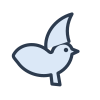
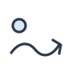
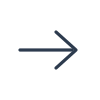

# おおぞら こころの たび — デザイン設計（design.md）

担当: art-director ／ 対象: `lesson-plan.md`（ユーザー確認ずみ）
読む人: motion-3d（3D演出）・sound-maker（音）・game-builder（組立）・game-tester（チェック）

---

## 1. テーマ「たびの てちょう」

ワークブック「大空に翔け」の **表紙の青い線の鳥** が、ワークブックの **紙の上** を とんでいく。
問題を1つ解くたびに、鳥が「とぶ みち」（点線）を1つ進み、ステップの おわりに **朱色のスタンプ** を1つもらう。
3つのスタンプがそろうと「今日 できた こと」のページになる。

- 手ざわり: 生成りの紙（#fffdf8）＋うすい紙のざらつき、青い手描き線、マスキングテープ、学校の先生の「はなまる」、朱のスタンプ
- ワークブックと同じ部品を使う: 分野の色（こころ・ことば・くらし）、黄色いヒント枠＋鳥、「ふりかえり」の線の上にのる見出し、4つの角がすこしずつちがう角丸
- 使わないもの: グラデーション背景、発光、すりガラス、やわらかい灰色の影（影は「紙をずらして重ねた」色つきの固い影だけ）、絵文字、赤い×
- いちばん目立たせるのは 1か所だけ: **上の「とぶ みち」と鳥**（＋ステップ1の ひょうざん）。ほかは静かにする

---

## 2. 色

| 名前（CSS変数） | 色 | 使う場所 | 文字に使えるか（紙 #fffdf8 の上） |
|---|---|---|---|
| `--paper` | `#fffdf8` | 背景の紙 | — |
| `--paper-edge` | `#f3ecdd` | ステージの外（16:9 からはみ出た所） | — |
| `--card` | `#ffffff` | カード・ボタンの紙 | — |
| `--ink` | `#2d3b4e` | 文字・線 | ○ 11.2:1 |
| `--ink-soft` | `#5d6876` | 小さい説明、「もういちど」札 | ○ 5.6:1 |
| `--rule` | `#9fb0c4` | 点線（かざりだけ） | × |
| `--kokoro` | `#3f6fb0` | **こころ＝青**。ステップ1、タイトル、鳥、主ボタン | ○ 5.0:1（白文字をのせても 5.1:1） |
| `--kokoro-tint` / `--kokoro-ink` | `#e9f1fb` / `#2f5a94` | 青のうす地 ／ その上の文字 | ○ |
| `--kotoba` | `#d9782d` | **ことば＝オレンジ**。ステップ2、手のはこ（線・面だけ） | × 3.1:1 → 文字は `--kotoba-ink` |
| `--kotoba-tint` / `--kotoba-ink` | `#fdeee0` / `#a85216` | 手のはこの地 ／ オレンジの文字 | ○ 5.3:1 |
| `--kurashi` | `#3f8f5f` | **くらし＝緑**。ステップ3（線・面だけ） | × 3.9:1 → 文字は `--kurashi-ink` |
| `--kurashi-tint` / `--kurashi-ink` | `#e8f3ec` / `#2f7a4d` | 場面の地 ／ 緑の文字 | ○ 5.2:1 |
| `--hint-bg` / `--hint-line` / `--hint-ink` | `#fffbea` / `#e8c95b` / `#7a5a00` | ヒント枠（ワークブックと同じ）／ヒントの見出し | ○ 6.2:1 |
| `--shu` | `#b8462a` | **はなまる・スタンプ・水の上のことばの吹き出しだけ** | ○ 5.2:1 |
| `--cloud` / `--cloud-tint` | `#5d6876` / `#eef0f2` | くものはこ（グレー） | ○ |
| `--water` / `--water-deep` | `#cfe1f5` / `#b9d3ef` | ひょうざんの水（文字は `--ink` で 8.5:1） | — |

- **ステップの色**: `.stage` に `data-step="1|2|3"` をつけると `--accent`・`--accent-tint`・`--accent-ink` が 青／オレンジ／緑 に切りかわる（問題文の下線、進み具合の○、番号札、ステップクリアの見出し）。
- **色だけで伝えない**: 正解＝太い線＋はなまる＋「せいかい」の札。まちがい＝点線のわく＋「もういちど」の札。ヒント＝黄色い太いわく＋鳥のマーク＋「ヒント」の文字。

---

## 3. 文字

| 役 | フォント | 太さ | 大きさ（1920基準） | 行間 |
|---|---|---|---|---|
| 問題文 `.question` | BIZ UDGothic（UDで読みまちがえにくい） | 700 | **44px** | 1.8 |
| 場面の文・しわけカード | BIZ UDGothic | 700 | 38〜40px | 1.85 |
| 選択肢 `.choice` | BIZ UDGothic | 700 | 32px（ステップ1の気持ちは 44px） | 1.75 |
| ボタン・ラベル・ふだんの文 | Zen Maru Gothic | 500 / 700 | 28〜40px | 1.6〜1.75 |
| タイトル・ほめことば・水の上のことば・見出し | Klee One（手書き風） | 600 | 40〜96px | 1.3〜1.7 |
| ふりがな `rt` | BIZ UDGothic | 400 | 親の 0.46倍 | 1 |

- いちばん小さい文字は 28px（`--fs-small`）。本文 32px、問題文 44px。
- フォントは `fonts/` に同梱（WOFF2・文字はけずっていない）。`local()` を先にさがす。ない環境の代わり: Hiragino Maru Gothic ProN → Meiryo → sans-serif。ライセンスは `fonts/README.md`。
- **ふりがな**: 設計書の `{漢字|かんじ}` は `<ruby>漢字<rt>かんじ</rt></ruby>` にする（`<rp>` は不要）。
  CSS で `rt` を上に うかせて（`position:absolute`）、**行の高さを広げない**。文の行間が 1.6 以上あるので、2行目のふりがなと1行目の字は重ならない。
  変換は1行でできる: `s.replace(/\{([^|}]+)\|([^}]+)\}/g, '<ruby>$1<rt>$2</rt></ruby>')`
- 読み上げ（`speechSynthesis`）には ふりがなを読ませる: `{漢字|かんじ}` → `かんじ` に置きかえた文を渡す。

---

## 4. 画面の わり方（全画面で共通。位置は動かさない）

基準 1920×1080 の `.stage` を1つ作り、画面に合わせて `--fit` 倍にする（1280×720 なら 0.667）。

```
y=0    ┌──────────────────────────────────────────────────────────────────────┐
       │ [ステップ1／もんだい2／4]  ●──◎(鳥)──○──○        [おと][うごき][もどる] │ .topbar   152px
y=168  ├──────────────────────────────────────────────────────────────────────┤
       │ (よむ)  問題文 ……………………………………………                              │ .qband    136px
y=320  ├──────────────────────────────────────────────────────────────────────┤
       │                     絵の場所（ステップごとに中身）                        │ .figure   244px
y=580  ├──────────────────────────────────────────────────────────────────────┤
       │   ┌①─────────┐   ┌②─────────┐   ┌③─────────┐                        │ .choices  300px
       │   └──────────┘   └──────────┘   └──────────┘                        │
y=896  ├──────────────────────────────────────────────────────────────────────┤
       │ (鳥) 鳥のことば／ヒント／ほめことば ……………………          [ つぎへ → ] │ .footer   160px
y=1056 └──────────────────────────────────────────────────────────────────────┘
        左右のよはく 48px ／ 行のあいだ 16px
```

- `.stage` は CSS grid（`grid-template-areas: "top" "question" "figure" "choices" "foot"`）。各画面の部品は `grid-area` で必ず同じ場所に入る。
- **固定するもの**: 進み具合（左上）、ツール3つ（右上）、よむボタン（問題の左）、選択肢（下から2段目）、つぎへボタン（右下）。
- つぎへボタンは使わないときも `hidden` で場所を残す（`.btn[hidden]` は `visibility:hidden`）。ヒントや ほめことばが出ても ボタンは動かない。
- ボタンはすべて 120×120px 以上、となりとは 24〜48px あける。

### 縮め方（game.js に入れる）
```js
const fit = () => document.documentElement.style.setProperty(
  '--fit', Math.min(innerWidth / 1920, innerHeight / 1080));
fit(); addEventListener('resize', fit);
```
JS が動かないときは `style.css` の `@media` が 0.9／0.8／0.7／0.66 に段階で縮める。
`.stage` は `transform: scale()` なので、3Dの座標は `getBoundingClientRect()` の値（画面のpx）をそのまま `Motion3D.celebrate(x, y)` に渡せばよい。

---

## 5. 各画面のレイアウト

### 5-1. タイトル
```
┌────────────────────────────────────────────────────────────────────┐
│                                                     (鳥 bird.svg)   │
│   おおぞら                                       ・・・・・          │
│   大空                                       ③(大人) ステップ3       │
│   こころの たび        ← Klee One 96px            こまった とき…    │
│                                             ・・                    │
│   気持ちに 気づいて、よい 行動を えらぼう   ②(手) ステップ2          │
│   ワークブック「大空に翔け」から              変えられる？…         │
│                                       ・・                          │
│   [ はじめる ]  ← 420×140 青            ①(ひょうざん) ステップ1      │
│                                    ・・  ことばの おくの 気持ち      │
└────────────────────────────────────────────────────────────────────┘
```
- 左寄せ。中央寄せの定型にしない。右は「たびの ちず」: 左下から右上へ点線のみちがのび、3つのステップが「とまる所」。終点に鳥。
- `.route-path` の path（そのまま使う）:
  `<svg class="route-path" viewBox="0 0 964 936" preserveAspectRatio="none" aria-hidden="true"><path d="M30 930C60 860 80 780 96 696S220 520 306 456 450 300 496 206 640 70 760 60"/></svg>`
- 3D: 紙の鳥と雲がこの右半分で ゆっくり うかぶ（`Motion3D.setScene('title')`）。左の文字の上には物を置かない。

### 5-2. おてほん（各ステップのはじめ）
問題と **まったく同じ配置**。ちがいは3つだけ。
1. 問題文の左上に マスキングテープ `<span class="tape">おてほん</span>`
2. 選択肢は `.is-locked`（押せない）。ゆびのカーソル `` が正解へ 0.9秒で動き、`.is-press` で押す
3. 下の帯は `.talk`（鳥＋ナレーション）。読み終わったら `つぎへ` を出す
- ステップ1: 吹き出し「むかつく！」→ 水の下に「くやしい」カードが ゆっくり うかぶ（CSS の transform 600ms、すくなめ設定では すぐ出す）
- ステップ2: しわけカードに `pic-shiori-typhoon.svg`。「台風」カードが くものはこへ（`.sort-card.is-flying` で はこの上まで動かし、はこが `.is-correct`）
- ステップ3: 給食の場面。ゆびが「先生に 相談する」を押す

### 5-3. 問題画面（3しゅるい。位置は同じ）

**ステップ1 ひょうざん（えらぶ 2つ）** — `data-step="1"`
```
 qband   (よむ) 水の 下に、どんな 気持ちが ありそう？
         ─────────────────────────────── 青い下線
 figure            ╭────────────╮
                   │ 「ウザい！」 │  ← .word-bubble（朱のわく、Klee One 64px）
 [水の上]           ╰─────┬──────╯      うれしい ことば（ありがとう）は .word-bubble--warm（緑）
         ~~~~~~~~~~~~~~~~~/\~~~~~~~~~~~~~~~~ ← 水面（iceberg.svg。figure と choices の さかい目）
 choices [水の下]  ┌①──────────────┐  ┌②──────────────┐
                   │ (顔)  思いどおり │  │ (顔)  たのしい   │   ← .choice（気持ちカード）44px
                   └────────────────┘  └────────────────┘     水の中に うかんでいる
```
- `.iceberg` は figure と choices の2段にまたがる背景（`grid-row: figure / choices`）。カードは水の中。
- 正解したら `.link-line`（青の点線）で 吹き出しの しっぽ → カードを むすぶ。

**ステップ2 手のはこ／くものはこ（しわける 2つ）** — `data-step="2"`
```
 qband   (よむ) この カードは、どっちの はこ？
 figure          ┌──テープ──────────────────┐
                 │ (絵)   天気               │  ← .sort-card（1まい、少し かたむいた紙）
                 └───────────────────────────┘
 choices   ┌①┄┄┄┄┄┄┄┄┄┄┄┄┄┄┐  ┌②┄┄┄┄┄┄┄┄┄┄┄┄┄┄┐  ← 上が点線＝口のあいた はこ
           │    (手)         │  │    (くも)       │
           │  手のはこ        │  │  くものはこ      │
           │ じぶんの 行動で  │  │ じぶんでは       │
           │ 変えられる       │  │ 変えられない     │
           └─────────────────┘  └─────────────────┘
           オレンジ .sort-box--hand   グレー .sort-box--cloud
```
- はこ自体が選択肢ボタン（`.choice.sort-box`）。クリック・1／2キーで、カードが そのはこへ入る（`.sort-card.is-flying`）。
- ヒントの「はこを少し揺らす」は `.sort-box.is-wiggle`（0.9秒×1回）。
- **第5問（かかわる？ スルー？）**: figure に `.sort-card`（pic-station.svg＋場面の文）と、右上に `.goal-card`（pic-clock.svg＋「目的: 時間どおりに 着く」）。choices は ふつうの `.choice` 2まい（`.sort-box` を つけない）。
- **第5問の前の せつめい**: `.sheet`（下の 5-6 と同じ紙）に テープ「せつめい」、左に pic-clock.svg、右に文。下の帯は `つぎへ`。

**ステップ3 場面と 3択** — `data-step="3"`
```
 qband   (よむ) あなたなら どうする？
 figure  ┌──────────────────────────────────────────────────────────────┐
         │ (場面の絵 240px)   給食を、となりの 子に 少し 食べられた。      │ ← .scene（緑のうす地）
         │                    となりの 子は ゲラゲラ わらって いる。      │   文 38px
         └──────────────────────────────────────────────────────────────┘
 choices ┌①────────────┐ ┌②────────────┐ ┌③────────────┐
         │ となりの 子を │ │ (先生マーク)  │ │ 大きな 声で   │  ← .choices--3（横に3つ）
         │ たたく        │ │ 先生に 相談   │ │ どなる        │     マークは文の上 .choice-mark
         └──────────────┘ └──────────────┘ └──────────────┘
```
- あやしいメール（第4問）は「いますぐ」「期限が 切れます」を `<span class="warn-line">` で黄色の太い下線。
- 万引き・メールの絵は、人の顔を出さない（pic-shop.svg・pic-mail.svg）。

### 5-4. せいかい
- 選んだ `.choice` に `.is-correct .is-locked`、中に `<span class="choice-badge">せいかい</span>`。右上に はなまる（CSS の ::after で自動）。
- 下の帯: `.praise`（bird-happy.svg＋ほめことば、Klee One 40px）。`つぎへ` が見えるようになる。
- のこりの選択肢も `.is-locked`。
- 3D: `Motion3D.celebrate(x, y)`（選んだカードの中心）。音: `Sound.play('correct')`。

### 5-5. まちがい・ヒント（責めない）
| 回目 | 選んだカード | ほかのカード | 下の帯 | 3D・音 |
|---|---|---|---|---|
| 1回目 | `.is-retry`（点線わく）＋札「もういちど」 | 絵の大事なところ（先生マーク・あやしいサイン）に `.is-hinted` | `.talk`（bird-tilt.svg）「もういちど みてみよう」 | `Motion3D.encourage()`／`Sound.play('retry')` |
| 2回目 | `.is-out`（うすく、押せない） | ステップ2 は正解のはこに `.is-wiggle`、ほかは正解に `.is-hinted` | `.hint`（hint-bird.svg＋「ヒント」＋ヒント文） | 同上 |
| 3回目 | まちがいは すべて `.is-out` | 正解に `.is-guide`（黄色わくが 2秒で1回 ゆっくり明るくなる。点滅ではない） | `.talk`「いっしょに おして みよう」→ 押したら「これで わかったね」 | 同上 |
- 赤・×・ゆれ・ブザーは使わない。点数は出さない。

### 5-6. ステップクリア
```
 topbar （のこす。○が ぜんぶ チェック）
 ┌テープ────────────────────────────テープ┐
 │  ╭─────╮     ステップ2 クリア            │ ← .sheet（1500×560、少し かたむいた紙）
 │  │スタンプ│    変えられない ことは「しかたない」と │   見出し Klee One 56px（ステップの色）
 │  ╰─────╯     受け止めて、いま できる ことを さがそう │   文 38px
 └────────────────────────────────────────┘
 footer                                                [ つぎへ → ]
```
- 3D: `await Motion3D.stepClear(n)` が スタンプを `.stamp` の場所へ「くるっ→ドン」と押す。3D が使えないときは `.stamp.is-pressed`（CSS で 0.5秒）で stamp-n.svg を出す。音: `Sound.play('clear')`。

### 5-7. ふり返り「今日 できた こと」
```
 topbar （進み具合は空。ツール3つだけ）
   今日 できた こと ← 線の上にのる見出し（ワークブックの「ふりかえり」と同じ形）
 ┌──────────────────────────────────────────────────────────┐
 │ (ice-small)   ことばの おくの 気持ちに 気づけたね      ( stamp ) │ .reflect-row
 │ ┄┄┄┄┄┄┄┄┄┄┄┄┄┄┄┄┄┄┄┄┄┄┄┄┄┄┄┄┄┄┄┄┄┄┄┄┄┄┄┄┄┄┄┄┄┄┄┄┄┄┄┄┄┄┄ │
 │ (mark-hand)   変えられる こと・変えられない ことを 分けられたね ( stamp ) │
 │ ┄┄┄┄┄┄┄┄┄┄┄┄┄┄┄┄┄┄┄┄┄┄┄┄┄┄┄┄┄┄┄┄┄┄┄┄┄┄┄┄┄┄┄┄┄┄┄┄┄┄┄┄┄┄┄ │
 │ (mark-adult)  こまった とき、大人に 相談する ことを えらべたね ( stamp ) │
 └──────────────────────────────────────────────────────────┘
 (鳥) まよったら、大人に 相談しよう。          [ もういちど ]  [ おわる ]
      あなたは 大空に とべるよ  ← .talk .reflect-last
```
- `.stamp-slot` は点線の丸。3D はここに スタンプを1つずつ並べる（`setScene('result')`）。3D がないときは中に stamp-1〜3.svg の `` を入れる。
- ボタンは右下（つぎへ と同じ場所）に「もういちど」（`.btn--sub`）と「おわる」（`.btn--primary`）。

---

## 6. HTML の組み方（見本）

```html
<div class="stage" id="stage" data-step="1" data-screen="question">  <!-- data-motion="less" で うごき すくなめ -->
  <div id="stage3d" class="stage3d"></div>

  <header class="topbar">
    <div class="progress">
      <p class="progress-label">ステップ<b>1</b>／ もんだい<b>2</b>／ 4</p>
      <ol class="flightpath" aria-hidden="true">
        <li class="flightpath-dot is-done"></li><li class="flightpath-dot is-now"></li>
        <li class="flightpath-dot"></li><li class="flightpath-dot"></li>
           <!-- style.left = いまの○の中心x -->
      </ol>
    </div>
    <nav class="tools" aria-label="せってい">
      <button class="tool-btn" aria-pressed="false">おと<small>あり</small></button>
      <button class="tool-btn" aria-pressed="false">うごき<small>ふつう</small></button>
      <button class="tool-btn">もどる</button>
    </nav>
  </header>

  <div class="qband">
    <!-- おてほんのとき: <span class="tape">おてほん</span> -->
    <button class="read-btn">よむ</button>
    <h2 class="question"><ruby>水<rt>みず</rt></ruby>の …</h2>
  </div>

  <div class="iceberg" aria-hidden="true"></div>                 <!-- ステップ1だけ -->
  <div class="figure figure--iceberg">…吹き出し…</div>
  <ul class="choices choices--2 choices--water">                 <!-- 3つなら choices--3 -->
    <li style="display:contents">
      <button class="choice"><span class="choice-key">1</span>
        
        <span class="choice-text">思いどおりに いかない</span></button>
    </li>
  </ul>

  <footer class="footer">
    <div class="talk"><p>…</p></div>   <!-- or .hint / .praise / .footer-spacer -->
    <button class="btn btn--primary next-btn" hidden>つぎへ</button>
  </footer>
</div>
```
- 画面を切りかえるときは `.stage` の中身を入れかえるか、`.screen`（`display: contents`）で囲んで `hidden` を切りかえる。
- 下の帯の中身は `aria-live="polite"` にして、ほめことば・ヒントを読み上げソフトにも伝える。
- 選択肢の絵は文と同じ意味なので `alt=""`（文がある）。`.choice-mark` だけは `alt="せんせいの マーク"` などを入れる。

---

## 7. 演出と音を出す場所

| とき | 画面の変化（CSS） | 3D（motion3d.js） | 音（bgm.js） |
|---|---|---|---|
| タイトル表示 | — | `setScene('title')` 紙の鳥3羽と雲が右半分に うかぶ | なし（まだ鳴らせない） |
| 「はじめる」 | — | `setScene('play')` | `Sound.start()`（BGM 小さくフェードイン） |
| 選択肢を押した瞬間 | `:active` で 4px しずむ | — | `play('tap')` |
| せいかい | `.is-correct`＋はなまる、`.praise`、鳥が とぶみちを1つ進む（600ms ばね） | `celebrate(x, y)` 紙ふぶき 1〜1.5秒 | `play('correct')` |
| まちがい | `.is-retry` 札「もういちど」、`.talk`（首をかしげる鳥） | `encourage()` 鳥が首をかしげる | `play('retry')` |
| ステップクリア | `.sheet` が出る | `await stepClear(n)` スタンプ（2秒以内） | `play('clear')` |
| ふり返り | `.reflect` | `setScene('result')` スタンプ3つが並び、1つずつ ふわっと明るく | `play('clear')` を1回だけ |
| うごき すくなめ | `.stage[data-motion="less"]`（CSSの動きを止める） | `setReducedMotion(true)` | — |
| おと なし | `.tool-btn[aria-pressed=true]` | — | `setMuted(true)` |

- **問題を解いている間**（`setScene('play')`）は、3Dは上の帯の右はし（ツールの左）と、画面のはし（左右 48px のよはく）の雲が ごくゆっくり動くだけ。**問題・絵・選択肢の上では何も動かさない。**
- 点滅は1秒に3回まで（このデザインでは いちばん速い動きでも `.is-guide` の 2秒に1回）。画面全体を光らせない。

---

## 8. クラス名一覧

### 土台
| クラス | 意味 |
|---|---|
| `.stage` | 1920×1080 の紙。`data-step="1/2/3"`（色の切りかえ）、`data-screen`（自由）、`data-motion="less"`（うごき すくなめ） |
| `.stage3d` / `#stage3d` | 3D のキャンバスを入れる層（z-index 40、押せない） |
| `.screen` | 画面のまとまり（`display: contents`。`hidden` でかくす） |
| `.sr-only` | 目には見えず、読み上げだけ |
| `.no-ruby` | ふりがなを かくす（先生用。親につける） |

### 上の帯
| クラス | 意味 |
|---|---|
| `.topbar` | 上の帯 |
| `.progress` / `.progress-label` | 進み具合のまとまり ／「ステップ1／もんだい2／4」（数字は `<b>`） |
| `.flightpath` | とぶ みち（点線）。`<ol>` |
| `.flightpath-dot` | ○1つ。`.is-done`（チェック）、`.is-now`（大きい○） |
| `.flightpath-bird` | いまの○の上の鳥。`style.left` を JS で動かす |
| `.tools` / `.tool-btn` | 右上のツール「おと」「うごき」「もどる」。中の `<small>` に今の状態 |

### 問題の帯・絵の場所
| クラス | 意味 |
|---|---|
| `.qband` | 問題の帯 |
| `.read-btn` | よむボタン |
| `.question` | 問題文 |
| `.tape` | マスキングテープの札（おてほん／せつめい） |
| `.figure` | 絵の場所。`.figure--iceberg`（ステップ1） |
| `.iceberg` | ひょうざんの背景（figure と choices にまたがる） |
| `.word-bubble` | 水の上のことば（朱）。`.word-bubble--warm`（うれしい ことば＝緑） |
| `.water-label` | 「水の上」「水の下」札。`--up` / `--down` |
| `.link-line` | 正解のあと ことばとカードを結ぶ SVG |
| `.sort-card` | ステップ2 の しわけるカード。`.is-flying`（はこへ動く） |
| `.goal-card` | ステップ2 第5問の めあてカード |
| `.scene` / `.scene-pic` / `.scene-text` | ステップ3 の場面 |
| `.warn-line` | あやしいサインの黄色い下線 |
| `.hand-cursor` | おてほんの ゆび。`.is-press` |

### 選択肢
| クラス | 意味 |
|---|---|
| `.choices` | 選択肢の段。`.choices--2`、`.choices--3`、`.choices--water`（ステップ1） |
| `.choice` | 選択肢ボタン |
| `.choice-key` | 番号札（1・2・3 キー） |
| `.choice-pic` | 選択肢の絵 |
| `.choice-text` | 選択肢の文 |
| `.choice-mark` | 先生・大人などのマーク（ステップ3） |
| `.choice-badge` | 「せいかい」「もういちど」の札 |
| `.sort-box` | はこ（`.choice` といっしょに）。`.sort-box--hand`、`.sort-box--cloud`、`.is-wiggle` |
| `.sort-box-label` | はこの名前と説明（名前は `<b>`） |
| ようす | `.is-correct`（正解）、`.is-retry`（まちがえた）、`.is-out`（候補から外した）、`.is-hinted`（ヒントで注目）、`.is-guide`（3回目、ゆっくり光る）、`.is-locked`（押せない） |

### 下の帯・ボタン
| クラス | 意味 |
|---|---|
| `.footer` | 下の帯 |
| `.talk` | 鳥＋ことば（ナレーション・はげまし） |
| `.hint` / `.hint-title` | 黄色いヒント枠 ／「ヒント」見出し |
| `.praise` | ほめことば（手書き風） |
| `.footer-spacer` | 帯が空のときの場所とり |
| `.btn` | ボタン。`.btn--primary`（青）、`.btn--sub`（紙） |
| `.next-btn` | つぎへ（いつも右下。`hidden` でも場所は残る） |

### 大きな紙・タイトル・ふり返り
| クラス | 意味 |
|---|---|
| `.sheet` / `.sheet-title` / `.sheet-text` | ステップクリア・せつめいの紙 |
| `.stamp` / `.stamp-label` | CSS版スタンプ。`.is-pressed` |
| `.title-screen` / `.title-main` / `.title-sub` / `.title-from` | タイトル画面 |
| `.start-btn` | はじめる（`.btn .btn--primary` と いっしょに） |
| `.route` / `.route-path` / `.route-stop` | たびの ちず（点線のみち・ステップの とまる所） |
| `.title-bird` | ちずの終点の鳥 |
| `.reflect` / `.reflect-title` / `.reflect-list` / `.reflect-row` / `.reflect-pic` / `.reflect-text` | ふり返り |
| `.stamp-slot` | スタンプを押す点線の丸 |
| `.reflect-last` | さいごのことば（下の帯の `.talk` の中） |
| `.deco-cloud` | 問題エリアの外の かざりの雲（動かさない） |

---

## 9. assets/ の一覧（すべて自作SVG、線 #2d3b4e・太さ3.2・まるい角）

| しゅるい | ファイル |
|---|---|
| 鳥（主人公） | `bird.svg`（ふつう）、`bird-happy.svg`（せいかい）、`bird-tilt.svg`（まちがい・かんがえる）、`hint-bird.svg`（ヒント・黄）、`bird-mark.svg`（線だけ） |
| はなまる・スタンプ | `hanamaru.svg`、`stamp-1.svg`（ひょうざん）、`stamp-2.svg`（手とくも）、`stamp-3.svg`（大人） |
| ツール・ボタン | `icon-read.svg`、`icon-sound-on.svg`、`icon-sound-off.svg`、`icon-motion.svg`、`icon-motion-less.svg`、`icon-back.svg`、`icon-next.svg`、`icon-again.svg`、`hand-cursor.svg` |
| ステップ1 | `iceberg.svg`（1920×560、水面 y=252）、`ice-small.svg`、`face-komari.svg`、`face-niko.svg`、`face-hide.svg`、`person-alone.svg`、`fist.svg`、`heart-give.svg` |
| ステップ2 | `mark-hand.svg`、`mark-cloud.svg`、`pic-shiori-typhoon.svg`（おてほん）、`pic-weather.svg`（1）、`pic-home-play.svg`（2）、`pic-quake-typhoon.svg`（3）、`pic-action.svg`（4）、`pic-station.svg`・`pic-clock.svg`（5） |
| ステップ3 | `pic-lunch.svg`（おてほん・1）、`pic-test.svg`（2）、`pic-fever.svg`（3）、`pic-mail.svg`（4）、`pic-shop.svg`（5）、`mark-teacher.svg`、`mark-adult.svg`、`mark-handup.svg`、`mark-phone.svg`、`mark-stop.svg` |
| ふり返り | `ice-small.svg`、`mark-hand.svg`、`mark-adult.svg` |
| かざり | `cloud-deco.svg`、`paper-grain.svg`（紙のざらつき。背景で使用ずみ） |

設計書の「絵や図のヒント」と ファイルの対応（ステップ1）: 第1問 ①face-komari ②face-niko ／ 第2問 ①face-niko ②face-hide ／ 第3問 ①person-alone ②face-niko ／ 第4問 ①fist ②heart-give。

---

## 10. 3D担当（motion-3d）へ: 色とモチーフ

**質感**: 紙。`MeshToonMaterial`（2〜3段のグラデーションマップ）か `MeshLambertMaterial`。光る素材・金属・発光・ブルームは使わない。輪郭は `#2d3b4e` の線（`EdgesGeometry`＋`LineBasicMaterial`）で「青い線の絵」に寄せる。

| モチーフ | 形 | 色 |
|---|---|---|
| **紙の鳥**（主役） | 表紙の鳥。平たい胴（三角の組み合わせ）＋大きな片翼1枚、少し折り紙ふう。翼を ゆっくり はばたく | 胴・翼 `#dbe8f7`、ふち線 `#2d3b4e`、目 `#2d3b4e` |
| **雲** | 平たい切り絵の雲（丸を3〜4こ合わせた板、厚み少し） | `#ffffff` と `#eef3f8`、ふち `#9fb0c4` |
| **紙ふぶき**（せいかい） | 小さな四角・三角の紙、くるくる回って落ちる。1回 40〜80まい | `#3f6fb0` `#d9782d` `#3f8f5f` `#e8c95b` `#fffdf8`（5色を同じくらい） |
| **スタンプ**（ステップクリア） | 円柱の はんこ（持ち手つき）が くるっと回って「ドン」。押したあとの印は stamp-n.svg と同じ図柄 | 印・ふち `#b8462a`、持ち手 `#e9dcc4`（木の色） |
| **はなまる**（任意） | 朱の線のうずまき（TubeGeometry） | `#b8462a` |
| 背景 | 色は塗らない（透明）。CSS の紙を見せる | — |

- 光: やわらかい `HemisphereLight`（空 `#ffffff`／地面 `#f3ecdd`）＋ `DirectionalLight` 1つ（影はこれだけ）。
- 場面ごとの位置:
  - `title`: 右半分（x > 960）。左の文字の上には置かない。
  - `play`: 上の帯の右はし（x 1320〜1440、y 0〜150）と、左右のよはく（48px）だけ。問題・選択肢の上には、`celebrate` の紙ふぶき（1.5秒で消える）以外は出さない。
  - `result`: `.stamp-slot` の位置（`getBoundingClientRect()` で取る）にスタンプを並べる。
- `stepClear(n)` のスタンプの図柄: 1＝ひょうざん、2＝手と雲、3＝大人。

## 11. BGM担当（sound-maker）へ
- 雰囲気: 「紙の鳥が晴れた空を ゆっくり わたる」。木琴・オルゴール・やわらかいパッド。テンポ 84〜92 くらい。
- 効果音は 7章の表のとき。せいかいの「ピロリン」は、鳥が とぶみちを1つ進む動き（600ms）と長さを合わせると気持ちいい。
- ステップクリアのファンファーレは、スタンプの「ドン」（`stepClear` の 開始から 約0.8秒）に いちばん強い音を合わせる。

## 12. 見やすさチェック（自分で確かめた）
- コントラスト: 本文 `#2d3b4e`／紙 11.2:1、青 5.0:1、オレンジ文字 `#a85216` 5.3:1、緑文字 `#2f7a4d` 5.2:1、ヒント文字 `#7a5a00` 6.2:1、白／青ボタン 5.1:1、`--ink` ／水 8.5:1。オレンジ `#d9782d`・緑 `#3f8f5f` は線・面だけ（3:1以上）。
- `.is-out` は うすい（押せない部品はコントラストの対象外）が、文は残して読める。
- フォーカス: どの押せるものも 6px の濃い線＋黄色の外わく（`:focus-visible`）。
- ボタン: ツール 120×120、よむ 120×120、選択肢 高さ 240 以上、つぎへ 280×120、はじめる 420×140。
- 1920×1080 と 1280×720 で全画面を表示して、はみ出し・重なりがないことを確認した。
